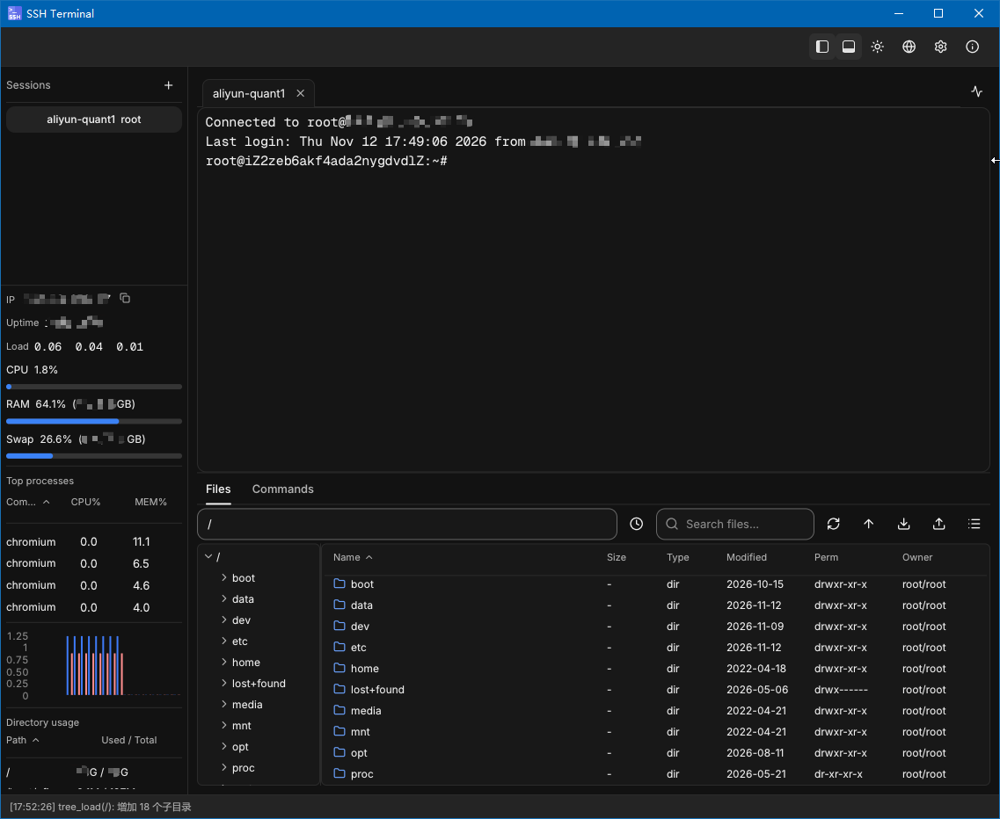

# SSH Terminal

An SSH terminal and SFTP file manager written in C with the CUI library and libssh, in a single file (`ssh_terminal.c`). Windows is the primary target; POSIX branches are kept. If this tool helps you, please give it a Star ⭐. Thank you! https://github.com/xuqb1/ssh_terminal

## Features

### Sessions and connection
- Multi-session management: create / edit / delete, double-click to open
- Multiple instances per session (tabs), titled to tell them apart
- Password authentication
- SSH private key authentication (global key path; tries the key first, falls back to password)
- Automatic reconnect on disconnect (exponential backoff, up to 60 s)
- Retry dialog on login failure, with editable username/password and a remember option

### Terminal
- Interactive shell, works with nano / vim and other full-screen programs
- Full Ctrl control codes (Ctrl+A..Z)
- Ctrl+Shift+V pastes from the local clipboard
- Ctrl+V sends literal next; Ctrl+C copies a selection or sends an interrupt
- Correct Shifted symbols (`Shift+-` gives `_`, etc.)
- Adjustable terminal font size (8–32), persisted
- ANSI colors (16 / 256 / 24-bit)
- Selection highlight, scroll follow, manual wheel scroll

### Live stats
- CPU / RAM / Swap usage
- Load average, uptime
- Network RX/TX rate with bar chart
- Process list (CPU% / MEM%)
- Disk usage by directory
- IP display with one-click copy (status bar + toast)

### SFTP file management
- Recursive directory tree on the left, file table on the right
- Columns: name, size, type, modified, permissions, owner/group
- Permissions shown as `drwxr-xr-x` (including setuid/setgid/sticky)
- File search filter (case-insensitive)
- Path input, up, refresh, recent paths
- Persistent navigation history (last 20 paths per session)
- Click empty space to clear selection; 50 px blank area at the bottom
- Hand cursor on hover, 10 px indent on the name column

### File operations
- New file / new folder
- Rename
- Delete (files and folders, recursively)
- Copy / cut / paste (auto `.bak` on name collision)
- File properties, folder properties (files, folders, size, permissions, owner, modified)
- Download: async chunks, progress, local disk space check
- Upload: async chunks, progress, remote disk space check
- Drag-and-drop upload: drop files/folders from the desktop, expanded recursively into a queue
- Folder upload: recursive collection, per-file upload, skip on failure
- Open downloaded files in an external editor; auto upload after edits
- Refresh the current folder after upload completes
- Transfer list: status, progress, cancel, open location, remove

### Context menus
- Right-click on a file/folder row: refresh, new, copy, cut, paste, download, upload, delete, rename, properties
- Right-click on empty space: refresh, new, paste, upload, properties (folder)

### Command panel
- Command list: name, created, actions
- Create / edit / delete
- Multi-line commands (shell highlighting, no wrap)
- Optional trailing CR
- One-click run, copy to clipboard, double-click to edit
- Commands persisted

### Port forwarding
- Local forward (-L): local port → address the remote can reach
- Saved per session, up to 8 tunnels per session
- Enabled tunnels start automatically on new instances
- Status: listening / stopped / error
- Non-blocking, does not stall the UI

### Interface
- Light/dark theme
- Chinese/English switch
- Window size, split ratios and panel visibility persisted
- Settings: download folder, external editor, SSH key, text file extensions and no-extension names
- Status bar log (last 100 entries); key actions also show a toast
- About dialog: features, contact, donation note

## Persistence

- Sessions and settings: `%APPDATA%\CUI\sessions.ini`
- Commands: `%APPDATA%\CUI\commands.ini`
- Transfer history: `%APPDATA%\CUI\updownload.ini`

On non-Windows, the same filenames in the current directory.

## Dependencies

- [CUI](https://github.com/yappologistic/CUI): immediate-mode GUI library, provides `cui.h`, `cui_app.h`, `cui_internal.h`, `cui_icons.h`
- [libssh](https://www.libssh.org/): SSH / SFTP
- Windows: MSVC or MinGW, link `comdlg32.lib`, `shell32.lib`, `ole32.lib`, `ws2_32.lib`

Add `ssh_terminal.c`, `my_terminal.c/h` and the CUI headers to one project, point the compiler at libssh's headers and libraries, and build.

## Building

Requires:
- A C compiler (MSVC / GCC / Clang)
- CUI (`cui.h`, `cui_app.h`, `cui_internal.h`, `my_terminal.h/.c`)
- libssh (with SFTP)
- Windows: `comdlg32.lib`, `shell32.lib`, `ole32.lib`, `ws2_32.lib`

Add `ssh_terminal.c` and its dependencies to your build. On Windows, place `ssh_terminal.ico` next to the executable; it is loaded at startup.

## Known limitations

- Private keys with a passphrase are not supported (falls back to password)
- Port forwarding supports local forward (-L) only; remote (-R) and dynamic (-D) are not implemented
- No path autocomplete
- No automatic file manager navigation after `cd`
- Folder uploads cannot be cancelled
- Window position is not persisted

## Contact

- WeChat: xsoft2005
- Email: qb_xu@126.com

Donations welcome. Thank you.

If this project is useful to you, a Star ⭐ goes a long way:
https://github.com/xuqb1/ssh_terminal

## License

Built on CUI (MIT). Follow their licenses.