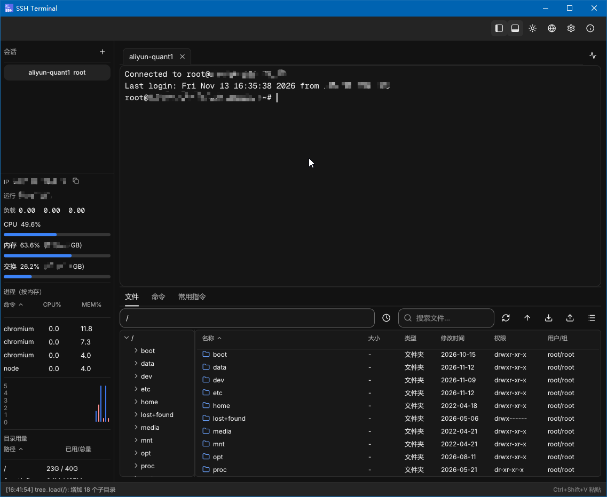

# SSH Terminal

一个用 C 语言 + [CUI 库](https://github.com/yappologistic/CUI) + [libssh](https://www.libssh.org/) 写的 SSH 终端与 SFTP 文件管理器，单文件实现（`ssh_terminal.c`），Windows 为主，POSIX 分支保留。如果这个工具对你有帮助，欢迎给个 Star ⭐，谢谢！https://github.com/xuqb1/ssh_terminal

## 功能

### 会话与连接
- 多会话管理：新建 / 编辑 / 删除，双击打开
- 同一会话可开多个实例（tab），标题自动区分
- 密码认证
- SSH 私钥认证（全局私钥路径，先试密钥，失败回退密码）
- 断线自动重连（指数退避，最长 60 秒）
- 登录失败弹重试框，可改用户名/密码，可选记住

### 终端
- 交互式 shell，支持 nano / vim 等全屏程序
- 完整 Ctrl 控制码（Ctrl+A..Z）
- Ctrl+Shift+V 从本机剪贴板粘贴
- Ctrl+V 发 literal next，Ctrl+C 有选区复制、无选区中断
- 符号键 Shift 正确（`Shift+-` 出 `_` 等）
- 终端字体大小可调（8–32），持久化
- ANSI 颜色（16 / 256 / 24 位）
- 选区高亮、滚动跟随、手动滚轮

### 实时统计
- CPU / 内存 / Swap 使用率
- 负载、运行时间
- 网络收发速率 + 柱状图
- 进程列表（CPU% / MEM%）
- 磁盘目录用量
- IP 显示 + 一键复制（状态栏 + Toast）

### SFTP 文件管理
- 左侧递归目录树，右侧文件表
- 列：名称、大小、类型、修改时间、权限、所有者/组
- 权限显示为 `drwxr-xr-x` 格式（含 setuid/setgid/sticky）
- 文件搜索过滤（大小写不敏感）
- 路径输入框、上一级、刷新、历史路径
- 导航历史持久化（每会话最近 20 条）
- 空白单击取消选中，底部 50px 空白区
- 悬停手型光标，名称列 10px 缩进

### 文件操作
- 新建文件 / 新建文件夹
- 重命名
- 删除（文件 / 文件夹递归）
- 复制 / 剪切 / 粘贴（同名冲突自动 `.bak`）
- 文件属性、目录属性（当前层文件数、文件夹数、大小、权限、所有者、修改时间）
- 下载：异步分块，进度显示，本地磁盘空间检查
- 上传：异步分块，进度显示，远程磁盘空间检查
- 拖拽上传：从本机拖文件/文件夹，递归展开队列
- 文件夹上传：递归收集，逐文件上传，失败跳过
- 下载后用外部编辑器打开；编辑后自动回传
- 上传完成自动刷新当前目录
- 传输列表：状态、进度、取消、打开位置、移除

### 右键菜单
- 文件/文件夹行右键：刷新、新建、复制、剪切、粘贴、下载、上传、删除、重命名、属性
- 空白区域右键：刷新、新建、粘贴、上传、属性（目录）

### 命令面板
- 命令列表：名称、创建日期、操作
- 新建 / 编辑 / 删除
- 多行命令（shell 高亮，不自动换行）
- 末尾添加 CR 选项
- 一键执行、复制到剪贴板、双击编辑
- 命令持久化

### 常用指令
- 内置 80+ 条常用 Linux 命令，分 8 个分类：
  文件与磁盘、进程与服务、网络、系统信息、文本处理、nano、vi/vim、Java
- 分类下拉过滤 + 名称/描述/代码搜索
- 按分类、名称、代码排序，默认按分类+名称
- 命令代码用 `{1}`..`{5}` 表示参数，双击打开参数表单
- 参数表单有中文/英文提示，填入后可预览、可编辑、一键执行
- 自定义命令：添加 / 编辑 / 删除，存外部文件，可跨会话复用
- 自定义命令有标识，与内置命令区分；内置只读
- 依赖外部包的命令在描述中注明“需要安装 xxx”

### 端口转发
- 本地转发（-L）：本机端口 → 远端可访问的地址
- 配置跟会话保存，每个会话最多 8 条
- 新实例连接时自动启动已启用的隧道
- 状态显示：监听中 / 已停止 / 错误信息
- 非阻塞处理，不卡 UI

### 界面
- 明暗主题切换
- 中英文切换
- 窗口大小、分隔条比例、面板显示持久化
- 设置窗口：下载目录、外部编辑器、SSH 私钥、文本文件后缀/无后缀列表
- 状态栏日志（最近 100 条）+ 右侧粘贴提示，关键动作同时弹 Toast
- 关于窗口：功能列表、联系方式、捐赠提示

## 设置持久化

- 会话与设置：`%APPDATA%\CUI\sessions.ini`
- 命令列表：`%APPDATA%\CUI\commands.ini`
- 常用指令自定义项：`%APPDATA%\CUI\linux_commands.ini`
- 传输记录：`%APPDATA%\CUI\updownload.ini`

非 Windows 下为当前目录同名文件。

## 依赖

## 依赖

- [CUI](https://github.com/yappologistic/CUI)：即时模式 GUI 库，提供 `cui.h`、`cui_app.h`、`cui_internal.h`、`cui_icons.h`
- [libssh](https://www.libssh.org/)：SSH / SFTP（源码：[gitlab.com/libssh/libssh-mirror](https://gitlab.com/libssh/libssh-mirror)，GitHub 镜像：[github.com/libssh/libssh-mirror](https://github.com/libssh/libssh-mirror)）
- Windows：MSVC 或 MinGW，链接 `comdlg32.lib`、`shell32.lib`、`ole32.lib`、`ws2_32.lib`

把 `ssh_terminal.c`、`my_terminal.c/h` 和 CUI 的头文件放进同一工程，配置好 libssh 的头文件和库路径即可编译。

## 构建

需要：
- C 编译器（MSVC / GCC / Clang）
- CUI 库（`cui.h`、`cui_app.h`、`cui_internal.h`、`my_terminal.h/.c`）
- libssh（含 SFTP）
- Windows：`comdlg32.lib`、`shell32.lib`、`ole32.lib`、`ws2_32.lib`

把 `ssh_terminal.c` 和依赖加入你的构建工程即可。Windows 下建议放一个 `ssh_terminal.ico` 在 exe 同目录，程序启动时会加载。

## 已知限制

- 带口令的 SSH 私钥暂不支持（会回退密码）
- 端口转发只支持本地转发（-L），远程转发（-R）和动态转发（-D）未实现
- 无路径自动补全
- cd 后不自动导航文件管理器
- 不支持取消文件夹上传
- 窗口位置不持久化

## 联系方式

- 微信：xsoft2005
- Email：qb_xu@126.com

欢迎捐赠，感谢支持。

如果这个项目对你有用，点个 Star ⭐ 支持一下：
https://github.com/xuqb1/ssh_terminal

## 许可

基于 [CUI](https://github.com/yappologistic/CUI)（MIT）和 [libssh](https://www.libssh.org/)（LGPL）。使用前请遵守各自许可。